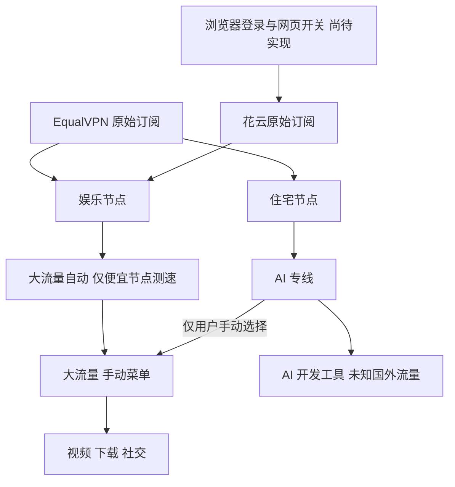

# OpenClash 双订阅自动更新工作流

更新于 2026-10-11。适用：UniFi 主路由 → Ser8 OpenWrt 旁路由（192.168.2.190），OpenClash + AdGuard Home。

## 配置结构

使用一份稳定的主配置 `peter-home.yaml`，由 mihomo 分别更新两个 HTTP proxy-provider。
服务商的策略组和 rules 不会覆盖自己的分流规则，也不需要重新生成整份配置才能刷新节点。

**当前完成的是配置生成、节点分类和内核验证；浏览器开关自动化尚未实现，也未部署新主配置。**
花云按用户说明，需要在网页打开更新权限。路由器的 HTTP provider 定时器不能操作这个网页，
修改 User-Agent 或改用原始订阅也不能替代这一步。

完整更新顺序应为：

1. 常开 Mac/NAS 上的浏览器使用花云现有登录状态进入产品页，下滚到订阅复制区域，点击允许访问订阅的按钮（仅在需要解锁时操作）。
2. 等网页显示操作成功，再拉取花云原始订阅，校验节点和插件参数；失败保留上次成功结果。
3. 触发路由器 provider 刷新，核对更新时间、节点数量与实际连通性。
4. 登录失效或出现需要人工处理的 Cloudflare 验证时，保留缓存并提示用户接手。

在实际找到开关、验证浏览器步骤并安装定时任务前，不能称为完整无人值守自动更新。
本次 Mac Chrome 能打开产品页，是在用户刚点击订阅复制区域的访问按钮并处理 Cloudflare 后。
当前解锁状态下按钮不显示；尚未验证下次失效时能由浏览器自动解锁。这不等于验证了独立浏览器或以后每次登录。
不能保证 Cloudflare 永不要求人工验证。建议使用现有 Chrome 会话，验证后再决定部署设备和运行方式。



| 项目 | 行为 |
|---|---|
| EqualVPN / 花云 | provider 每 3600 秒尝试刷新，走 DIRECT；花云成功前提是网页允许更新 |
| Provider 健康检查 | 每 300 秒 HTTPS 204 探测，lazy: false |
| 大流量自动 | url-test：花云实际节点 + EqualVPN 娱乐；排除住宅和套餐提示，故障时也不引用 AI 专线 |
| 大流量 | 默认大流量自动；允许手动选择 AI 专线、地区组或单节点 |
| AI 专线 | 默认住宅节点；不引用大流量组 |
| 花云分类 | 香港 / 日本 / 新加坡 / 美国；其他地区仍进入便宜池 |
| 住宅筛选为空 | empty-fallback: REJECT，避免住宅消失后悄悄直连 |
| 下载失败 | 保留最后成功节点；构建器拉取/验证失败不覆盖主配置 |

便宜节点全部失效时，大流量自动可能仍显示某个失效的便宜节点；它不会自动借用住宅。
需要在“大流量”菜单手动选择“AI 专线”，再在“AI 专线 → 住宅节点”内选目标住宅节点。
便宜出口恢复后，手动选择会保留；用户自行把“大流量”切回“大流量自动”。

## 本次实际检查

- 路由器实时 API：当前旧内核是 `alpha-g24b6de7`；花云 HTTP provider 最后成功更新停在
  `2026-07-04T09:30:01.849684669Z`；旧 `AI 专线` 只有 1 个住宅节点。
- 新 EqualVPN 链接：HTTP 200，11 个节点（1 个住宅、10 个娱乐）。
- 花云 Clash 转换器：HTTP 403。该转换 URL 的 `url=` 内嵌的官方原始订阅可拉取，
  是不补齐 padding 的 Base64 SIP002 SS 订阅，含 simple-obfs 参数。
- mihomo v1.19.32 实际刷新原始订阅成功：EqualVPN 11 个、花云 88 个（另有 2 个套餐提示被过滤）；
  便宜池 98 个；花云香港、日本、新加坡、美国各 12 个。
- 花云原始响应的 Content-Type 是 `text/html`，但内容实际为 Base64；不能仅凭 HTTP Content-Type 拒绝它，
  也不能只看 HTTP 200 就判断成功。构建器校验内容、节点字段和 obfs 参数。
- 真实主配置通过 mihomo v1.19.32 `-t` 校验；故障和恢复用回环地址模拟代理验证。

补充核验（2026-10-11）：用户确认花云开关已打开后，通过路由器现有 API 触发 `huayun` 更新，
返回 HTTP 204，最后成功更新时间变为北京时间 **10:09:06**，载入 90 条记录（含套餐提示）。
因此 7 月 4 日是刷新前的旧状态，花云 provider 当前已成功更新。
新配置也再次拉取成功；隔离内核对住宅及 4 个花云样本做真实 HTTPS 连通性测试，均成功，延迟 77–352 ms。

**此次已刷新路由器上的花云 provider，但新的主配置和手动 AI 入口还未部署到路由器。**
路由器 LuCI 尚需登录，SSH 无可用认证；当前仍是原有分流结构。最终需在路由器验证新配置的浏览器更新流程和手动切换。

## 生成配置

真实链接仅保存在仓库已忽略的 `inno/auto-update/sources.json`，不提交。格式：

```json
{
  "equalvpn": "EqualVPN 的完整原始订阅 URL",
  "huayun": "花云原始订阅 URL，或用户提供的 api-huacloud.com 转换 URL"
}
```

构建器会从已知花云转换 URL 中提取官方 `api.xmancdn.net` 原始订阅，运行时不依赖转换器。

从仓库根目录执行（需要 Python 3 + PyYAML；路由器运行时不需要 Python）：

```bash
python3 config/clash/openclash/build_config.py --sources inno/auto-update/sources.json
```

生成目录 `inno/auto-update/bundle/`：

- `peter-home.yaml`：可导入 OpenClash 的私有主配置。
- `proxy_provider/peter-{equalvpn,huayun}.yaml`：本次下载并校验过的节点缓存，供首次启动使用。
- `rule_provider/*.yaml`：已下载的规则缓存；运行后继续按各自 interval 更新。

配置、节点缓存均含凭据。生成文件以 0600 权限写入；输出日志只展示节点数量，不打印 URL。
网页开关开启后可用此脚本生成配置；它不包含浏览器操作，也不会安装定时任务。

## 导入路由器

1. 先备份当前 OpenClash 配置、UCI 设置和自定义覆写脚本。保留旧配置文件以便切回。
2. 将 mihomo / Meta 内核更新到支持本配置的版本。本次测试版本为 v1.19.32；不要仅凭 YAML
   能解析就认定旧 alpha 内核支持 Base64、前缀和 `empty-fallback` 等行为。
3. 将生成的 `peter-home.yaml` 上传到 OpenClash「配置管理」。新主配置已经含完整规则，
   **停用旧的自定义注入脚本和额外规则/策略组覆写**，避免它们改写策略组。
   仓库最新版 `custom_overwrite.sh` 已对 `peter-home.yaml` 跳过注入；如果路由器仍是旧版，需更新该脚本或停用它。
   保留 OpenClash 现有的端口、TUN、DNS 和防火墙管理设置。
4. 如果使用 SSH，将 `proxy_provider/`、`rule_provider/` 的内容放入 `/etc/openclash/` 下同名目录，
   主配置放 `/etc/openclash/config/peter-home.yaml`。OpenClash 通常使用 `/etc/openclash` 为内核 HomeDir；
   先核对实际 `-d` 参数，缓存相对路径必须位于该目录。没有缓存也能从网络首次下载。
5. 切换到 `peter-home.yaml` 并重启 OpenClash。主配置作为本地文件管理，不把 EqualVPN 或花云
   填进「整份配置订阅」去覆盖它；两个 provider 的 `interval` 负责更新节点。
6. 在面板「代理集合」分别执行一次更新，核对两家更新时间。隔一小时再次核对，确认定时更新在路由器上成功。
7. AI 专线选 `住宅节点`，大流量选 `大流量自动`；清理旧的节点选择记录或核对实际选择，避免历史手动 pin。
8. 家庭验证：ChatGPT/Claude → AI 专线；YouTube/下载 → 大流量；淘宝/微信 → DIRECT。
   确认 AdGuard Home 仍工作，旁路由 DNS 没有回环、端口冲突；最后进行受控的便宜节点断线/恢复验证。

失败时切回旧配置并恢复覆写脚本。不要把「策略组不存在」或「配置校验失败」当作可忽略的提示。

### DNS 与家庭旁路由

主配置 DNS 默认监听 7874，不占用 AdGuard/dnsmasq 的 53。OpenClash 的插件覆写以现有家庭部署为准，
继续保持 UniFi、客户端网关/DNS 和 AdGuard Home 的现有接入链路。
仓库快照与当前实时 API 的 IPv6 状态不同，迁移时要核对，不能按旧快照盲目变更 UniFi 网络。

生成器把本次两家节点的 server 端点直连规则放在最前，降低手机 Stash 在家庭 Wi-Fi 下的双重代理风险。
**这只是构建时快照，不会随着 provider 节点变化自动变动。** 新服务器域名/IP 出现后，重新生成配置或维护
`direct-rules.yaml`；路由器自身的 provider 下载与节点拨号不依赖这份手机端点快照。

## 检查更新，避免长期静默过期

沿用 `clash_traffic.py` 的 `CLASH_API_SECRET` 与可选 `CLASH_API_BASE`：

```bash
python3 config/clash/openclash/check_providers.py
python3 config/clash/openclash/check_providers.py --refresh
```

默认只读；`--refresh` 请求 mihomo 更新两家 provider。检查器确认 HTTP provider、节点数和最后更新时间，
超过 3 小时未成功更新会以非零退出码提示；同时检查自动池排除住宅以及手动 AI 入口。
它是排障工具，未安装定时器或通知服务。路由器只负责定时拉取和健康检查，花云网页环节尚未接入。

403/HTML 登录页、套餐过期、订阅 token 被重置、服务商撤销链接都不会被「多刷新几次」修复。
EqualVPN 当前 URL 的签名参数内编码了住宅服务器/UUID 等信息；服务商变更住宅信息时，旧链接是否随之更新
取决于它的服务端实现，不能承诺旧签名链接一定能获取新住宅。需要新链接时，在本地 sources 文件替换后重新构建。

## 规则维护和测试

规则优先级保持：局域网/节点端点/直连 → AI + 开发工具 → 明确媒体和下载 → 国内 → 国外兜底（默认 AI 专线）。
继续使用本仓库四份 rule-provider 与 blackmatrix7 规则，每 24 小时刷新。流量大不自动改变业务分类：
一个 AI 请求即使下载很多，也不会因此被统计工具直接改成便宜出口。

```bash
MIHOMO_BIN=/path/to/mihomo python3 -m unittest discover -s config/clash/openclash -v
```

测试覆盖订阅失败保留配置、缺少住宅停止构建、Base64/obfs/套餐提示解析，以及实际内核的新增节点刷新、
更新失败保留节点、便宜出口全故障仍排除住宅、手动切到 AI 专线实际可访问、恢复后保留手动选择、
以及住宅筛选为空时拒绝直连。

参考：[mihomo provider 配置](https://wiki.metacubex.one/config/proxy-providers/)、
[支持 YAML/URI/Base64](https://wiki.metacubex.one/config/proxy-providers/content/)、
[策略组字段](https://wiki.metacubex.one/config/proxy-groups/)、
[url-test 策略组](https://wiki.metacubex.one/config/proxy-groups/url-test/)。


## 提供给其他人

分发模板、生成器、检测脚本与说明，接收者填自己的两家订阅并自行登录花云。
不要发送自己的 sources.json、浏览器登录状态、生成配置或 provider 缓存。
模板使用此仓库和 blackmatrix7 的公共规则；分享包不包含个人节点凭据。
浏览器开关步骤尚未实现，分享包也不能宣传为完整无人值守更新服务。
如需给多人提供在线订阅，应分别保存每人的凭据并提供独立私有入口；目前没有部署这样的服务。
